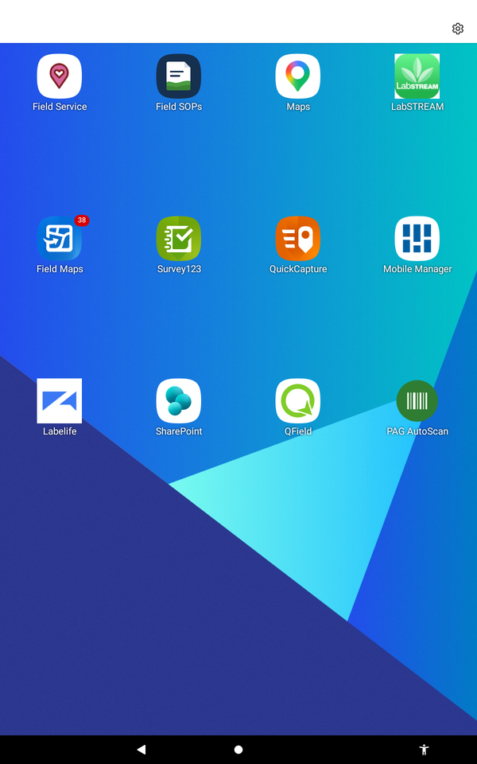
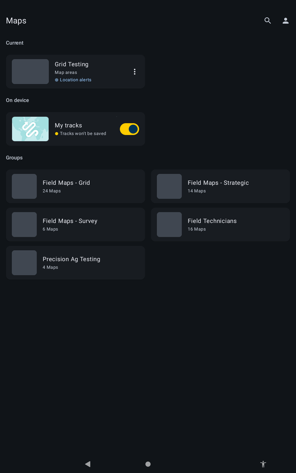
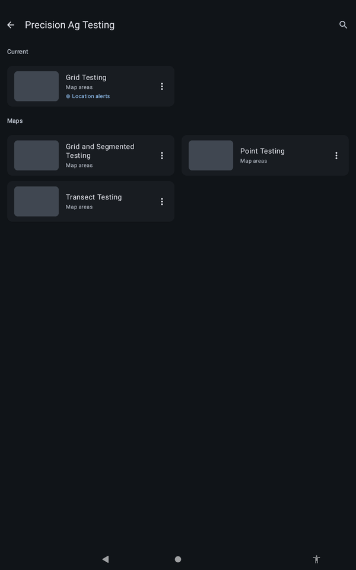
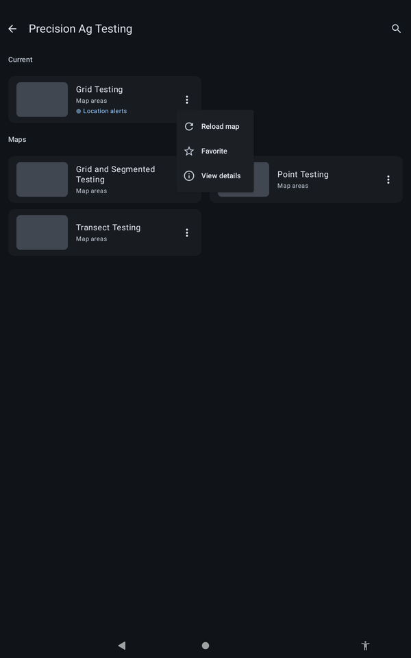
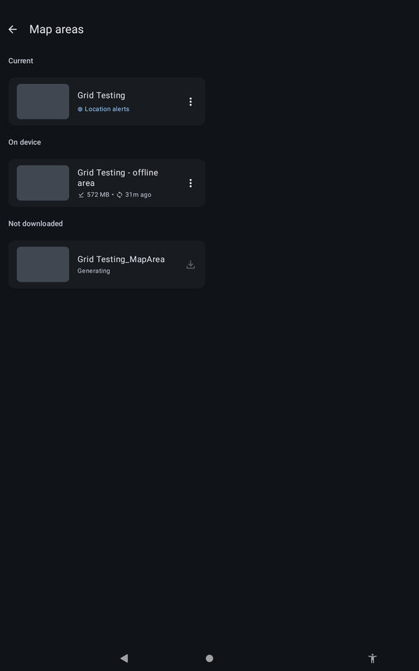

# :material-download: Download Your Job Before Leaving

Find your job and save it to the tablet while you still have a connection.

!!! warning "DRAFT, pending sign-off"
    Steps marked `[CONFIRM]` have not been checked on a tablet yet. Do not rely on them in the field until they are cleared.

!!! warning "WARNING"
    Always download your job **before you leave**. Do not rely on coverage in the paddock.

## Find the job

1. Connect the ET45 to a network (office Wi-Fi or a hotspot).
2. Open **Field Maps** from the home screen. `[CONFIRM: sign-in steps if prompted]`

{ width="300" }
*The Field Maps icon on the ET45 home screen.*

3. On the **Maps** screen, open the **group** for your job type. Each kind of work has its own group.
4. Search for your **Deal ID**. Check the job name matches the job you were given.

{ width="300" }
*The Maps screen. Each group holds the maps for one kind of work.*

{ width="300" }
*Inside a group. This one is Precision Ag Testing.*

!!! note "NOTE"
    The menu on a map's three-dot button has Reload map, Favorite and View details. Downloading is done from **Map areas**, in the next step.

{ width="300" }
*The three-dot menu on a map.*

## Download it

1. Open the map. The **Map areas** screen shows what is on the tablet and what can be downloaded.
2. Under **Not downloaded**, tap the download arrow next to your map area. `[CONFIRM: exact steps and wording]`
3. Wait for the download to finish. Do not leave, or close the app, until it has.
4. Check it now appears under **On device**. If it does not, do not leave. Contact [Support](09-support.md).

{ width="300" }
*Map areas. "On device" is saved on the tablet, "Not downloaded" can be downloaded.*

!!! tip "TIP"
    A large area around the paddocks is preloaded, so you can still move around the map when you are offline.
