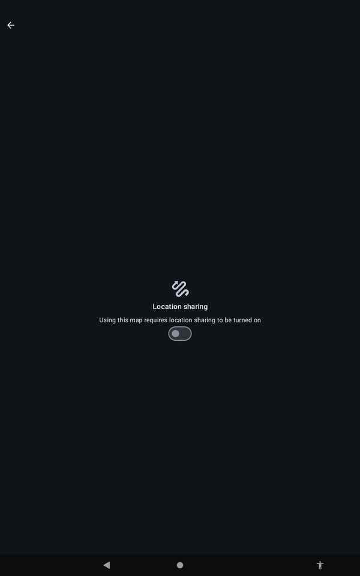
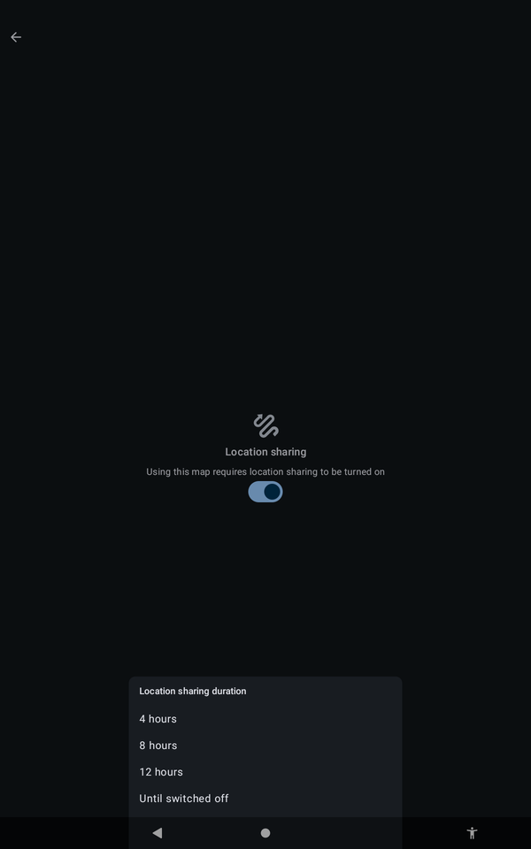
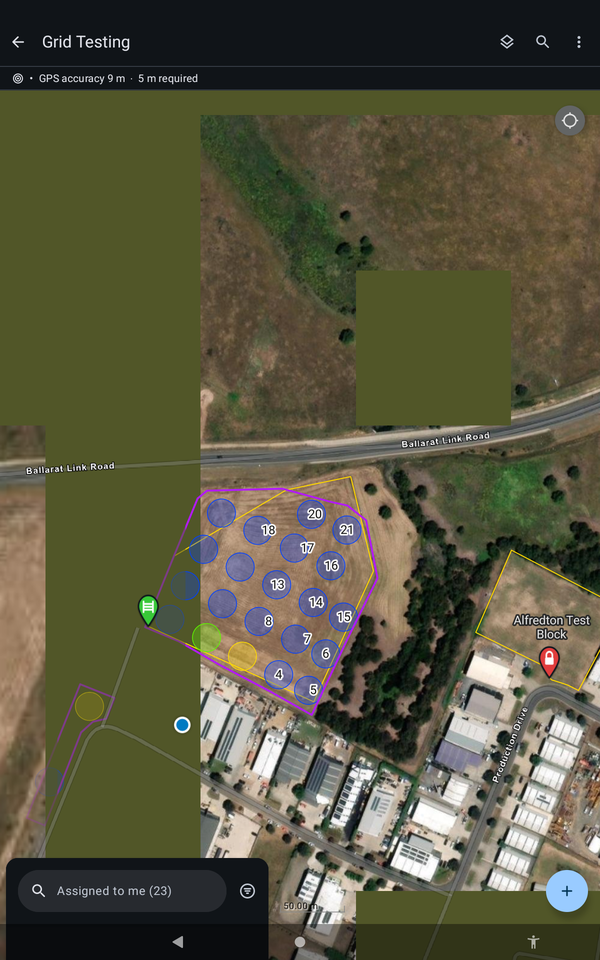

# :material-crosshairs-gps: Open the Job on Site

Turn on location sharing and check your GPS before you start.

!!! warning "DRAFT, pending sign-off"
    Steps marked `[CONFIRM]` have not been checked on a tablet yet. Do not rely on them in the field until they are cleared.

## Open the job and share your location

1. Open Field Maps, open the group for your job type, and open your job. A downloaded job opens without coverage.
2. Field Maps shows **Location sharing**. Turn the switch on.

{ width="300" }
*Location sharing. The map needs it turned on.*

3. Choose how long to share: **4 hours**, **8 hours**, **12 hours** or **Until switched off**. `[CONFIRM: which one technicians should pick]`

{ width="300" }
*Choose how long location sharing stays on.*

!!! warning "WARNING"
    You have to do this every time you open the job. If location sharing is off, your position does not show and your tracks are not recorded.

## Check your position and GPS accuracy

1. Check your position marker is in the right place on the map.
2. Look at the bar at the top of the map. It shows your **GPS accuracy** and the accuracy **required**. The target is under 5 m.

{ width="300" }
*The GPS accuracy bar, for example "GPS accuracy 9 m, 5 m required".*

`[CONFIRM: what to do if accuracy stays above 5 m]`
