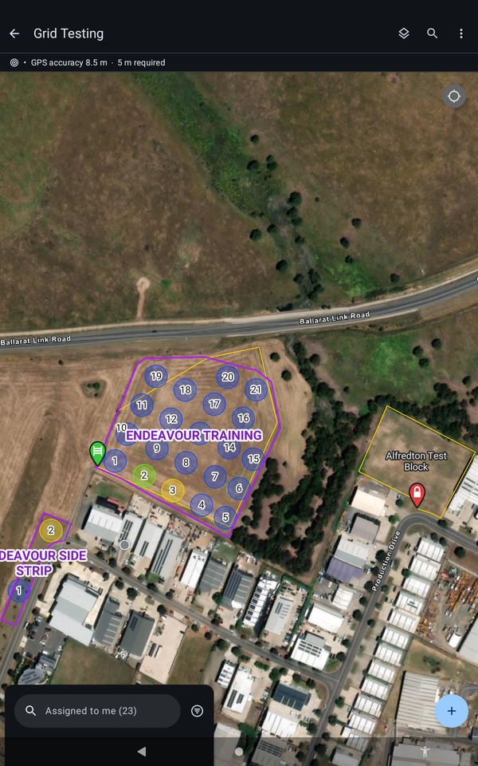
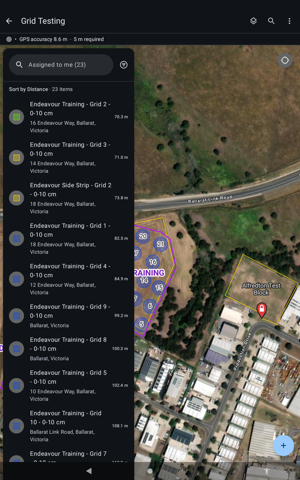
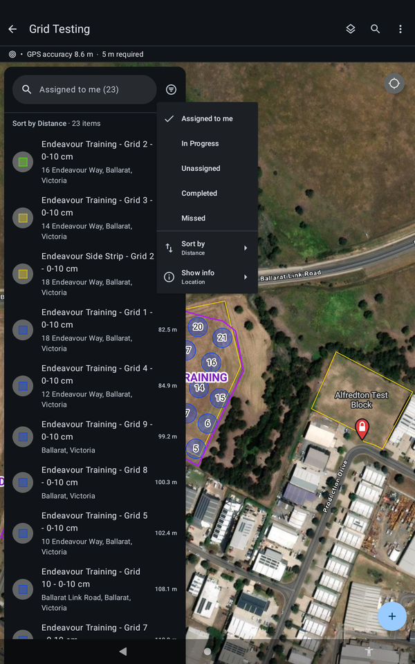
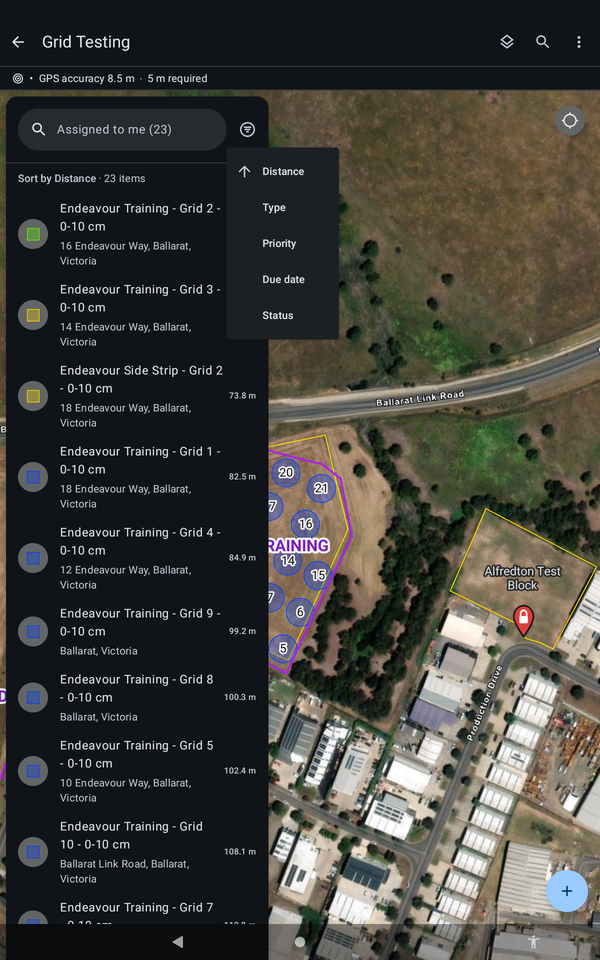

# :material-format-list-checks: Find Your Tasks

Your points are assigned to you as tasks. The task list is at the bottom left of the map.

!!! warning "DRAFT, pending sign-off"
    Steps marked `[CONFIRM]` have not been checked on a tablet yet. Do not rely on them in the field until they are cleared.

## Open the task list

1. Tap the task list at the bottom left of the screen. It is labelled with the filter in use, for example **Assigned to me (23)**.
2. Your tasks are listed, sorted by distance from you.

{ width="300" }
*The task list sits at the bottom left of the map.*

{ width="300" }
*The task list. "Sort by Distance" is the default.*

## Choose what you see

Tap the filter button next to the search box.

| Filter | Shows |
| --- | --- |
| Assigned to me | All of your tasks. This is the default |
| In Progress | Only points still to do. Points drop off the list as you finish them, which some technicians prefer |
| Unassigned | Points not assigned to anyone |
| Completed | Points already done |
| Missed | Points that were not reached |

All points are set to **In Progress** before you arrive, so there is nothing to change at the start.

{ width="300" }
*The filter menu.*

## Change the order

Choose **Sort by**: **Distance**, **Type**, **Priority**, **Due date** or **Status**. Tap Distance again to flip between closest first and farthest first. `[CONFIRM: how to list points in number order, 1, 2, 3]`

{ width="300" }
*The Sort by menu.*

