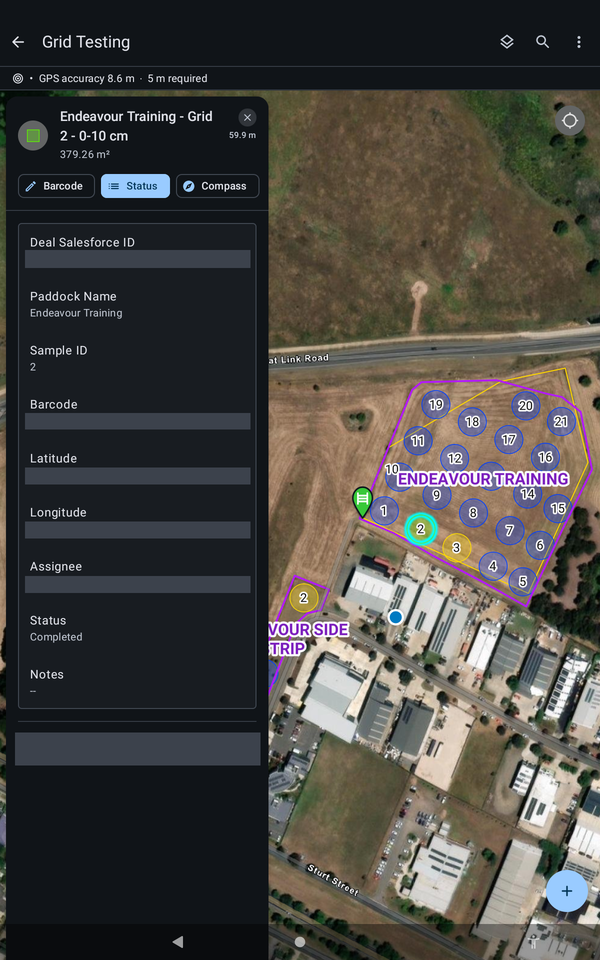

# :material-map-marker-path: Navigate to a Point

Pick a point, get to the right gate, and watch your accuracy as you arrive.

!!! warning "DRAFT, pending sign-off"
    Steps marked `[CONFIRM]` have not been checked on a tablet yet. Do not rely on them in the field until they are cleared.

1. Select a point from the task list, or tap it on the map.
2. Check its colour. Points change colour with their stage (see the table below).
3. Use the **gate pins**. They mark the easiest way into the paddock. Head for the gate first, then the point.
4. As you arrive, watch the GPS accuracy bar. The target is under 5 m. `[CONFIRM: what to do if accuracy stays above 5 m]`

{ width="300" }
*A point open. Its colour on the map matches its status.*

## What the colours mean

| Colour | Status |
| --- | --- |
| Blue | Assigned to you, not started |
| Yellow | In Progress |
| Green | Completed |
| Red | Missed |

A point's panel has three buttons: **Barcode**, **Status** and **Compass**. `[CONFIRM: when to use Compass]`

!!! note "NOTE"
    This screenshot has the Deal ID, barcode, coordinates and user name blanked out. Your screen will show them.
