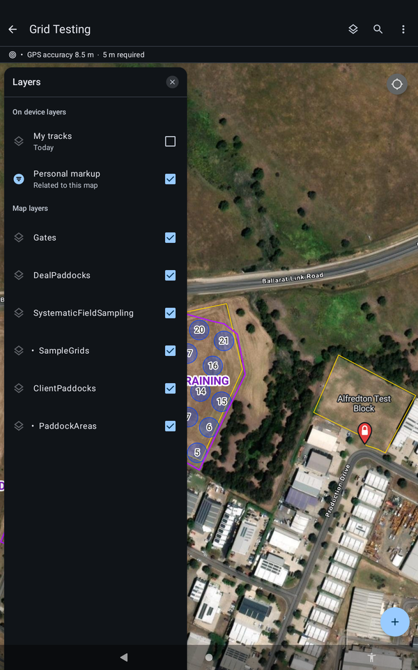

# :material-layers: Layers and Tracks

Switch map content on and off, and see where you have already been.

!!! warning "DRAFT, pending sign-off"
    Steps marked `[CONFIRM]` have not been checked on a tablet yet. Do not rely on them in the field until they are cleared.

## Open Layers

Tap the **Layers** button at the top right of the map.

| Group | Layer | What it is |
| --- | --- | --- |
| On device layers | My tracks | The path you have travelled today |
| On device layers | Personal markup | Your own notes drawn on the map |
| Map layers | Gates | Gate pins |
| Map layers | DealPaddocks, ClientPaddocks, PaddockAreas | Paddock boundaries |
| Map layers | SystematicFieldSampling, SampleGrids | The sampling points and grids |

`[CONFIRM: what each paddock and sampling layer is, in plain words]`

{ width="300" }
*The Layers panel.*

## Show where you have been

1. Open **Layers**.
2. Tick **My tracks**.

This is most useful on segmented work. You can see where you have already been, so you do not cover the same point twice.

{ width="300" }
*My tracks switched on.*

!!! tip "TIP"
    Turn off layers you do not need if the map looks crowded.
