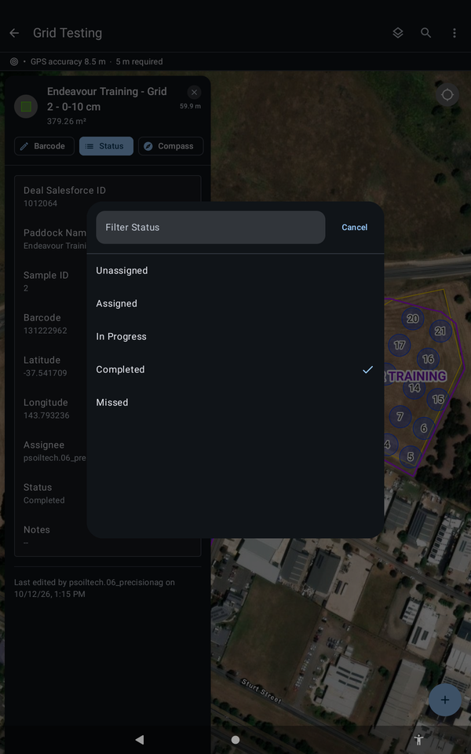

# :material-map-marker-check: Work Each Point

What to do at a point, and what to do when you cannot get there.

!!! warning "DRAFT, pending sign-off"
    Steps marked `[CONFIRM]` have not been checked on a tablet yet. Do not rely on them in the field until they are cleared.

!!! info "AT A GLANCE"
    Scan each bag as you go. Label every bag. If you cannot reach a point, mark it **Missed** and leave a note.

1. Open the point and do the work using the book for your job type.
2. **Scan each bag as you go.** This is best practice and stops bags getting mixed up later.
3. **Label every bag.**
4. If you run out of bags and use supermarket bags, label them clearly. You can rescan them when you are back at base.

## If you cannot reach a point

1. Open the point and tap **Status**.
2. Choose **Missed**.
3. Leave a **note** saying why. `[CONFIRM: where the note is entered]`

The status choices are **Unassigned**, **Assigned**, **In Progress**, **Completed** and **Missed**.

{ width="300" }
*The status choices. Do not pick one by accident.*

`[CONFIRM: does the status change to Completed by itself when the point is finished?]`
