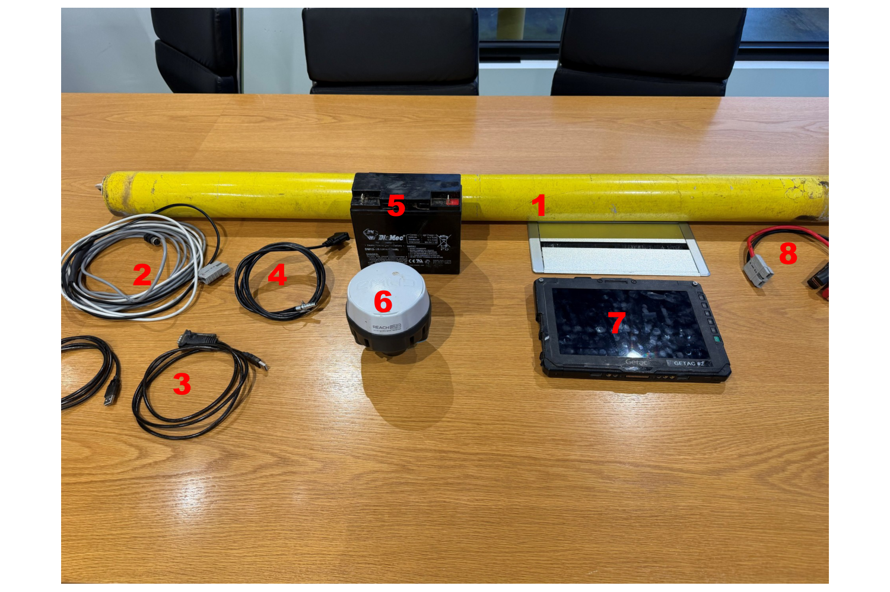

# :material-package-variant-closed: Equipment Required

Before heading out, make sure you have the following kit. Pack against this list. A
missing cable can cost you a whole job.

!!! info "AT A GLANCE"
    DualEM unit, power and data cables (DB9), DB9-to-USB cables, a GPS (Emlid or Ag
    Leader) with its cable, cable ties or tape for securing cables, a power source for
    the DualEM, and the Getac. If there is no CORS coverage, bring a second GPS as a
    base station.

*The full survey kit, numbered to match the list below.*

## Kit list

- [ ] **DualEM unit**
- [ ] **2 × Power & Data Cable.** If running wired, use the cable with a **DB9 connector**.
- [ ] **2 × DB9 to USB cables**
- [ ] **Emlid Reach RS2+/RS3 cable** with DB9 connector, plus a **portable charger bank**
      and **USB-C cable**.
- [ ] **Power source for the DualEM.** Your Polaris or ute will have an integrated power
      source. If not, bring a battery with an **Anderson-to-alligator-clamp** connector
      *(see Figure 8 in the photo above)*.
- [ ] **Emlid GPS RTK receiver** (or an **Ag Leader** GPS)
- [ ] **Getac computer** or other approved surveying device
- [ ] **Cable ties, tape or velcro**, for securing cables to the cradle. Cables break
      easily on brush.
- [ ] **Second GPS configured as a base station**, only if there is no CORS coverage at
      the job. An Emlid gets its corrections from the CORS network.

!!! note "NOTE"
    Your ute or Polaris is already fitted with a DualEM cradle. You do not need to
    bring one. Wired is the standard connection, so pack the cables above. Newer
    equipment can run wirelessly if the digital team has confirmed it.

!!! tip "TIP"
    Charge the Emlid charger bank and the Getac the night before. Field techs lose more
    survey time to flat batteries than to anything else.
