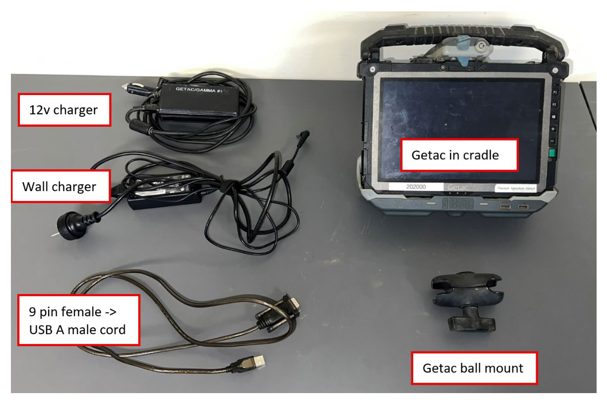
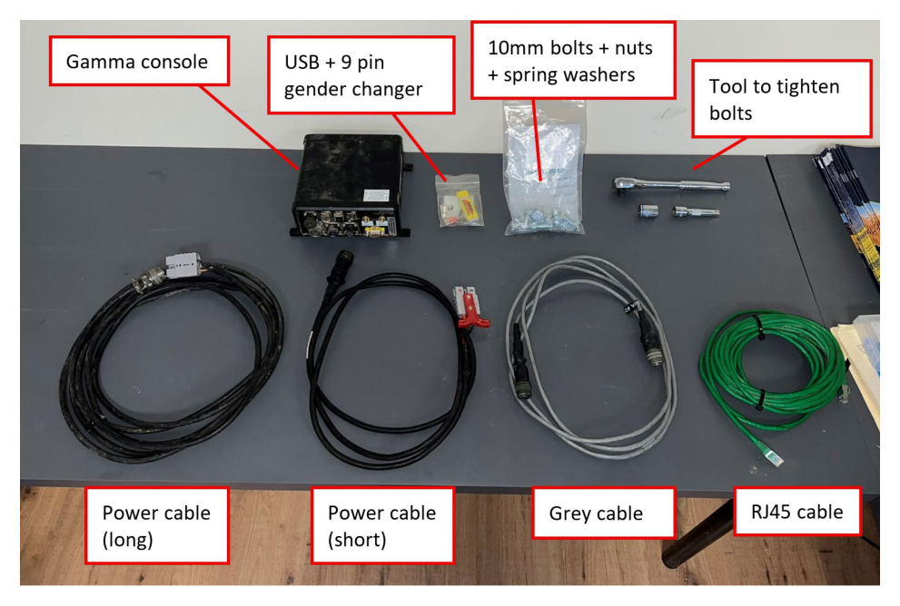
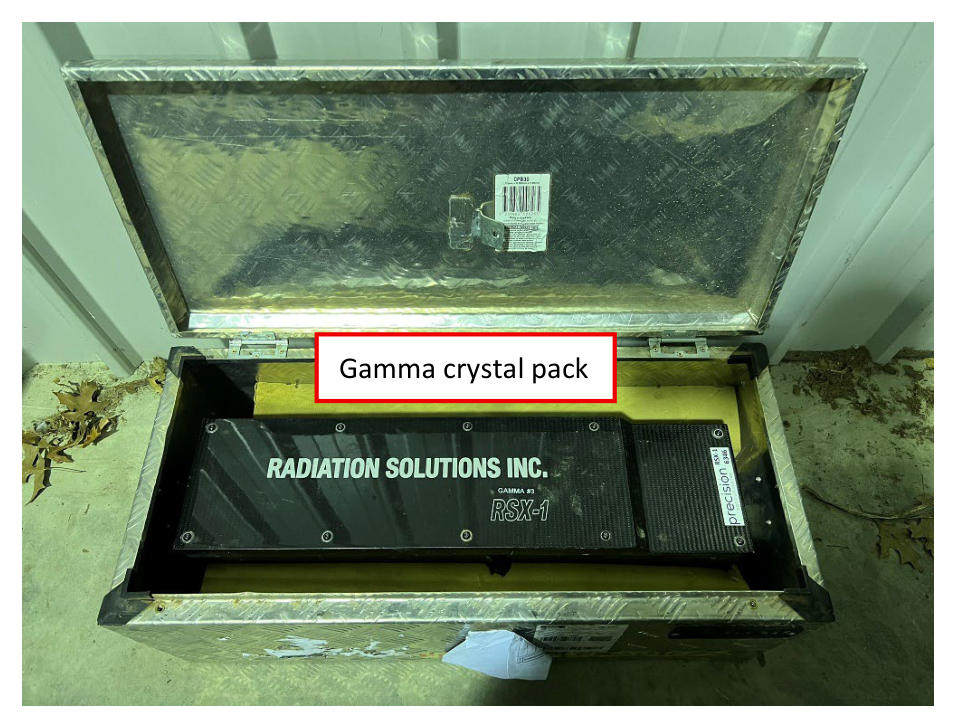
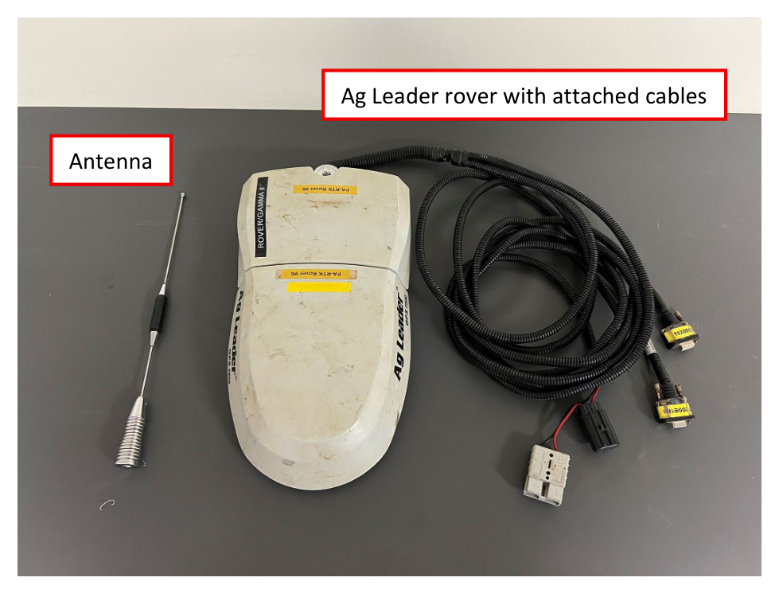

# :material-package-variant-closed: Equipment Required

Before heading out, make sure you have the following kit. Everything is organised by
box, pack against each list and check nothing has been left behind.

!!! info "AT A GLANCE"
    Boxes: Getac, gamma console (the gamma box), crystal pack (its own case), and the
    rover case. The crystal pack travels separately from everything else. Bring the
    Starlink, cable ties or tape, and a second GPS as a base station if there is no CORS
    coverage.

## Getac box

- [ ] Getac computer
- [ ] Gamber-Johnson Getac cradle
- [ ] Getac ball mount
- [ ] Wall charger
- [ ] 12V car/Polaris charger

*Getac box: 12V charger, wall charger, Getac in its cradle, and the ball mount.*

## Gamma console unit box (the gamma box)

- [ ] Gamma console
- [ ] RJ45 or Cat 6 data cable (gamma box to the Getac cradle)
- [ ] 9-pin gender changer
- [ ] Black power cable (Anderson to gamma console plug), **short**
- [ ] Black power cable (Anderson to gamma console plug), **long**
- [ ] Grey cable (gamma crystal pack to gamma console)
- [ ] USB thumbdrive, **plus a backup** in case of failure, **formatted to FAT32**
- [ ] 10mm bolts, nuts and spring washers
- [ ] Tool to tighten bolts (adjustable wrench, socket spanner, etc.)

*Console, USB and 9-pin gender changer, 10mm hardware, tools, and the cables: long and
short power, grey (crystal pack), and the data cable.*

## Gamma crystal pack travel case

- [ ] Gamma crystal pack (Radiation Solutions RSX-1), **kept in its own case, separate
      from everything else, to avoid damage**
- [ ] Mounting bracket and clips
      `[CONFIRM: bracket contents, and whether it travels in this case or the console box.]`

*The crystal pack in its dedicated travel case.*

## Rover case

- [ ] GPS rover, **Ag Leader or Emlid**, with its power cable and antenna
- [ ] Emlid only: portable charger bank and USB-C cable
- [ ] **Second GPS (another Emlid or an Ag Leader) configured as a base station**, with a
      power source. Needed if you are using an **Ag Leader** or there is **no CORS coverage**

*Ag Leader rover with its cables attached, and the antenna.*

## Also bring

- [ ] **Starlink**. You will need it for remote support. LTE works in a pinch but is very
      slow and drops out.
- [ ] Cable ties, tape or velcro, for securing cables
- [ ] 12V battery (elevation surveys only, charged the night before)

!!! danger "SWMS"
    Minimise shock to the gamma crystal pack at all times, it is fragile. Never drive with it unmounted or unsecured.
