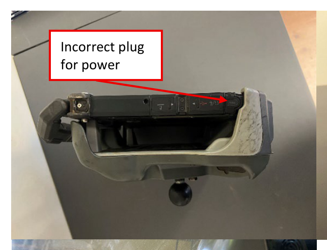
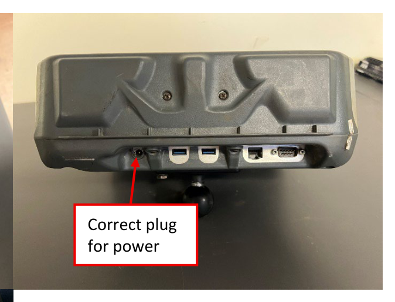
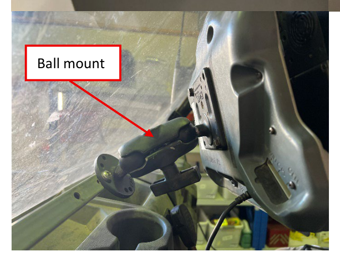

# :material-laptop: Getac Setup

Mount the Getac and find today's job folder before you start rigging the gamma
equipment.

!!! info "AT A GLANCE"
    Plug power into the **cradle**, not the Getac directly. An unpowered cradle will not
    pass on the gamma data, and plugging into the Getac means later connections won't
    function. GIS has already staged your job folder in SharePoint, so you don't create
    one.

## 1. Mount and power the Getac

Lock the Getac into the cradle and mount it to the vehicle using the ball mount. Plug
the 12V power cable into the car/Polaris on one end and the **bottom of the Getac
cradle** on the other.

!!! warning "WARNING, wrong plug breaks later connections"
    Do not plug the power cable into the Getac directly. If you do, the cable
    connections you make later (the gamma box data cable) won't function.

-   
    **Incorrect**, do not plug in here.

-   
    **Correct**, plug into the bottom of the cradle.

*Getac mounted and ready.*

Turn on the Getac and log in.

## 2. Find the job folder

On the desktop is a shortcut to **PA Survey - General**. Open it and find your job's
folder by **Deal ID**. GIS has already put everything you need in there before you
left:

- the paddock **boundary** file (.kml or .kmz)
- the working folders for the job
- a **Gamma** folder, for the gamma files

If the folder, the boundary or the gamma folder is missing, contact GIS. Do not create
your own.

!!! note "NOTE"
    Keep each survey day's gamma files in their own folder, named with the date. Mixing
    days together causes confusion later.

---

Next: [Gamma Rig Setup](03-gamma-setup.md). Mount the crystal pack, gamma box and GPS.
