# :material-radioactive: Gamma Rig Setup

Mounting the crystal pack and gamma box, connecting the GPS, getting live data flowing in
RadAssist, and setting up Subsoil for guidance. This follows on from
[Getac Setup](02-getac-setup.md).

!!! info "AT A GLANCE"
    Bolt the crystal pack to the bracket on the front of the vehicle with the power
    connection on the **passenger side**. Route cables through the passenger window so
    the door doesn't pinch them. The GPS plugs **directly into the gamma box**, not the
    Getac. Confirm three green boxes and live data in RadAssist before you start
    surveying.

!!! danger "SWMS"
    The crystal pack is worth over $100,000. Do not drop it or knock it. Carry it with
    both hands and keep it in its own case until it is time to mount it.

## 1. Mount the bracket and crystal pack

Slot the bracket into the pre-installed slots on the front of the Polaris or ute and
secure it with the clips. Remove the gamma crystal pack from its travel case, place it
on top of the bracket and bolt it on with the 10mm bolts, spring washers and nuts. Make
sure every bolt is fitted and tight.

Ensure the **power connection for the crystal pack faces the passenger side** of the
vehicle.

!!! note "NOTE"
    Fit the bracket before the survey and remove it after. Do not leave it on the front
    of the vehicle when driving. `[CONFIRM: wording, and add a photo of the bracket and
    crystal pack on the vehicle.]`

## 2. Place and power the gamma box

Place the gamma box in the cab of the ute, or strap it behind the seat of the Polaris.
Connect it to the vehicle using the black power cable and the **pre-installed Anderson
plug**. Every surveying ute and Polaris has one.

!!! note "NOTE, ute routing"
    If using a ute, route the cable through the passenger window to avoid it being
    pinched by the door.

-   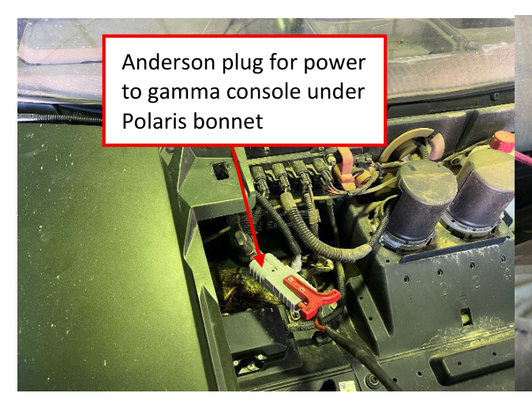
    Anderson plug for console power, under the Polaris bonnet.

-   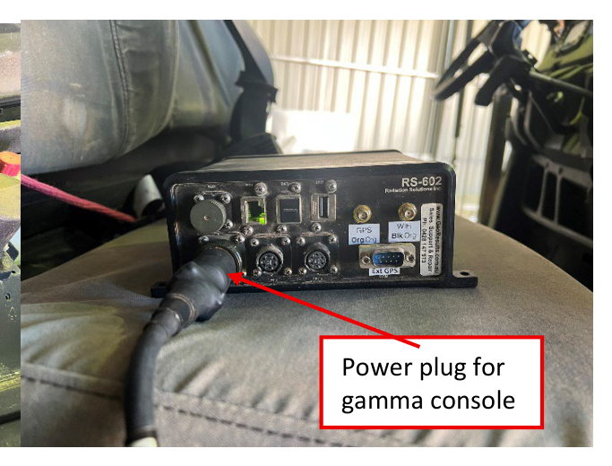
    Power plug on the gamma box.

## 3. Connect the gamma box to the crystal pack

Connect the gamma box to the crystal pack using the **grey cable**. Again, route
through the passenger window on a ute to avoid pinching.

-   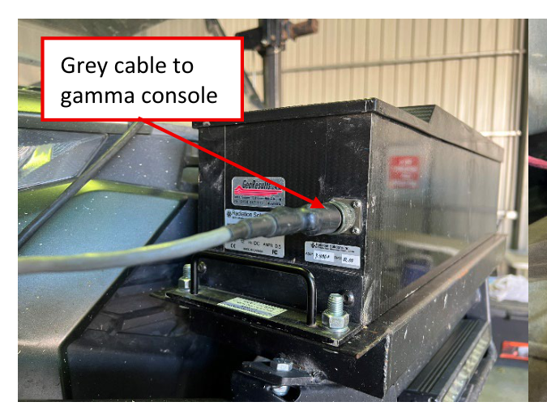
    Grey cable at the gamma box end.

-   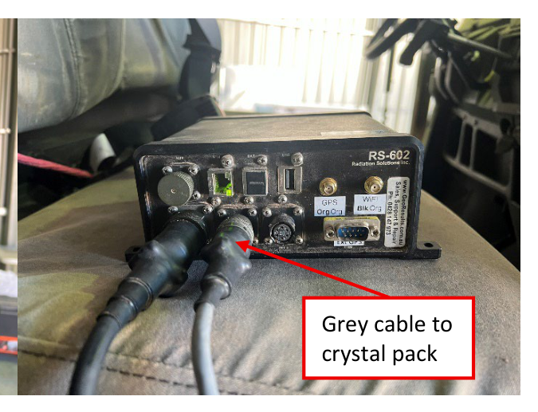
    Grey cable at the crystal pack end.

## 4. Connect the Getac

Plug the **green data cable** into the bottom of the Getac cradle on one end and the
gamma box on the other. This is where the gamma data, and the GPS signal, reach the
Getac.
`[CONFIRM: green RJ45 cable, or a DB9 cable as in the field notes?]`

-   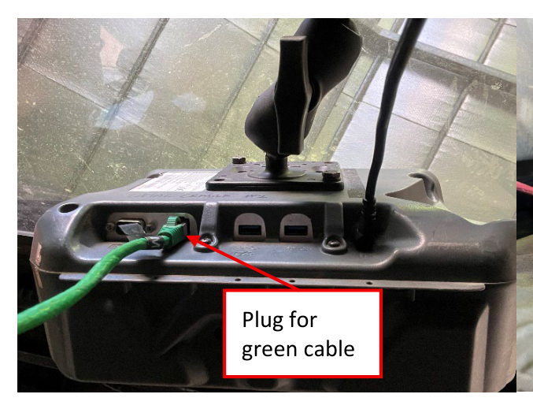
    Green cable into the Getac cradle.

-   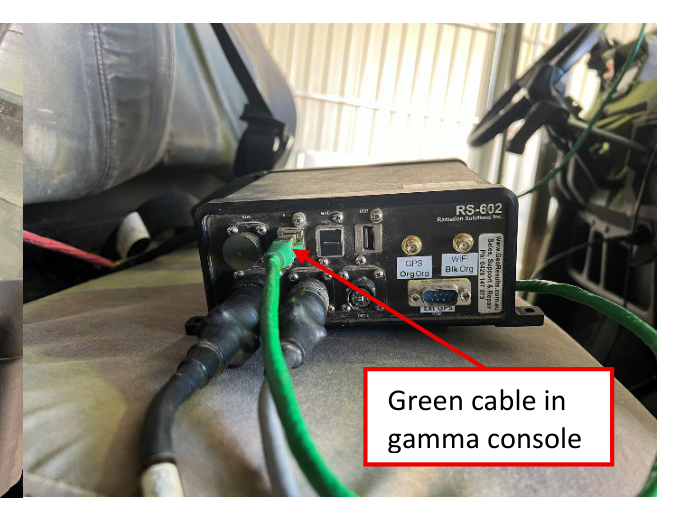
    Green cable into the gamma box.

!!! warning "WARNING"
    If the cradle is not powered it will not pass on the gamma data. This is the most
    common fault. See [Getac Setup](02-getac-setup.md).

## 5. GPS and corrections

Both **Ag Leader** and **Emlid** GPS units are used. For gamma surveys the GPS must be
plugged **directly into the gamma box**. This is different to other surveys, where the
GPS goes into the Getac. The data cable then carries the GPS signal across to Subsoil.

1. Ag Leader: connect the antenna to the rover.
   Emlid: switch it on, powered from the portable charger bank via USB-C.
2. Place the rover on the **roof of the vehicle** (the metal plate for the Polaris) and
   connect its power. On the Polaris use the Anderson plug in the back tray.
3. Plug the rover's 9-pin GPS cable into the gamma box, with the gender changer
   attached to the gamma box.
   `[CONFIRM: is this now a single GPS cable into the gamma box only? The August procedure
   had two rover cables, 1Hz to the gamma box and 5Hz to the Getac.]`
4. Route the cable through the passenger side window. Secure it with cable ties, tape or
   velcro so it cannot snag or be pinched, and tighten the connector screws lightly to
   hold it in place.

-   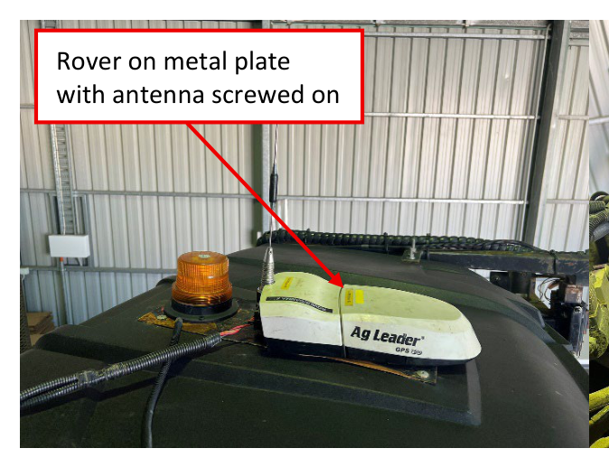
    Rover mounted with antenna screwed on.

-   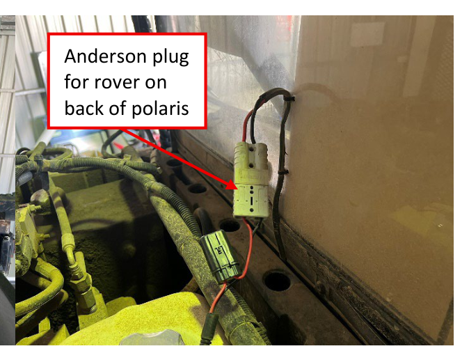
    Rover power, Anderson plug at the back.

### Corrections

- **Emlid:** it connects to the **CORS network** to get its corrections. Check it shows
  connected before you start.
  `[CONFIRM: how the Emlid reaches the CORS network in the field (Starlink or a hotspot)
  and what the tech checks to see it is connected.]`
- **No CORS coverage:** you need a **second GPS configured as a base station**. Set it up
  and check the rover is receiving its corrections.
  `[CONFIRM: how the base station is set up, who configures it, where it sits, and
  whether the Ag Leader uses CORS or the base.]`

## 6. Connect in RadAssist

Turn the vehicle's ignition on. On the Getac, open **RadAssist** (on the desktop).
RadAssist finds the gamma unit by itself and the settings are already configured.

If it does not connect by itself:

1. Click **File** then **Connect to Device**.
2. Select the **RS-602AG**.
3. Click **Connect**.
4. Click **Start Recording** if it is not already recording.

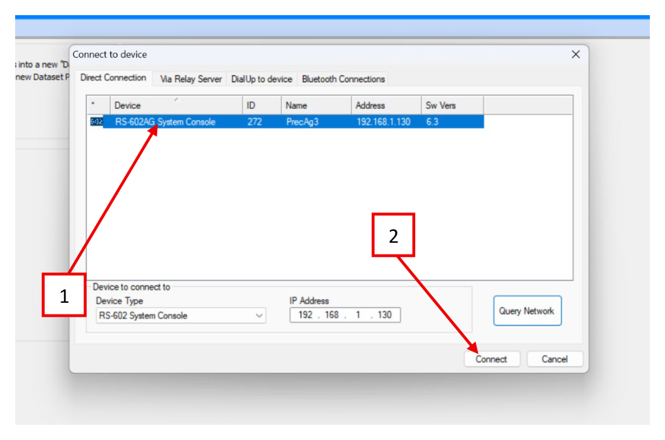
*Select the RS-602AG System Console, then Connect.*

## 7. Verify the connection

If everything is set up correctly, RadAssist shows:

- [ ] Three green boxes lit at the top of the window, with the crystal pack confirmation
- [ ] A rainbow data stream (like a mass spectrometer readout) under the **Live Data
      View** tab at the bottom
- [ ] Data being recorded, shown under **Device connection** at the top

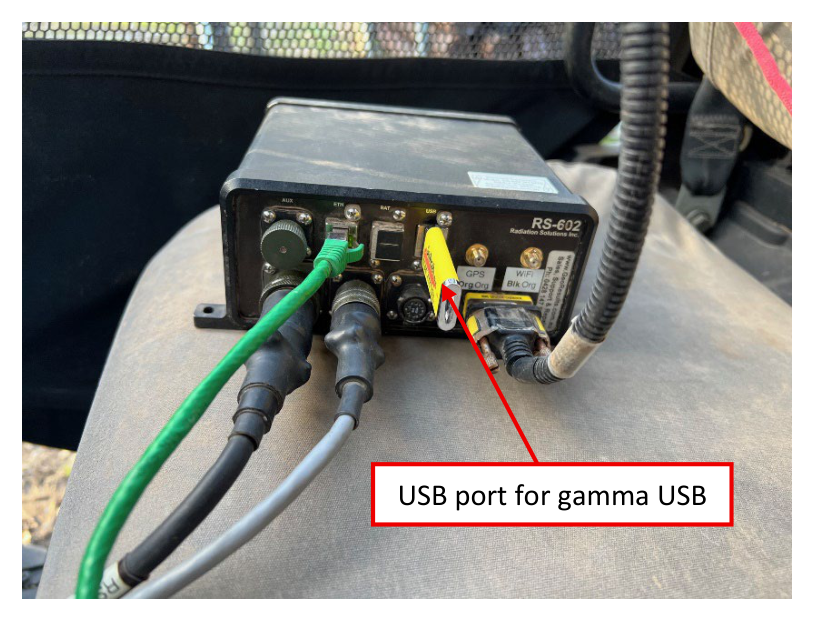
*Three green boxes, live data streaming, and recording confirmed.*

!!! note "NOTE"
    If these conditions aren't met, the gamma unit may need a few minutes to configure.
    This can happen periodically, and especially after the unit has moved a long
    distance between jobs. Leave it and check back later, see
    [Troubleshooting](06-troubleshooting.md) if it doesn't resolve.

Minimise RadAssist but **do not close it**. It keeps running in the background and sounds
an alarm if the gamma or the GPS disconnects.

## 8. Set up Subsoil

Subsoil gives you the GPS fix and the guidance. Swath width, speed and the A-B line all
work the same as an EM survey.

1. On the Getac, open **Subsoil** from the desktop shortcut.
2. Tap **Setup**, then **Quick Start**.
3. Pick the boundary file (.kml or .kmz) from your job's folder in **PA Survey - General**.
4. Subsoil scans for equipment automatically. Check the GPS is found, then tap **Apply**.
5. Confirm the **green RTK FIX** shows, and the boundary appears on the map.
6. Check the **swath width for your device in Salesforce Field Service**. It is set per
   device. Set it in Subsoil under **Guidance**.

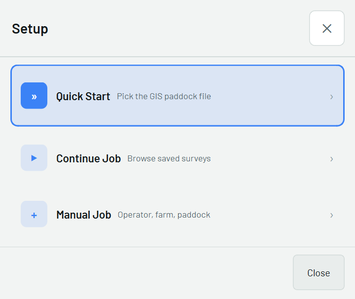
*Setup, then Quick Start, then pick the boundary file from the job's folder.*

`[CONFIRM: does Subsoil write its own survey file during a gamma survey, or is it GPS and
guidance only? Subsoil also warns when it is not receiving data.]`

## 9. Survey the paddock

1. Position the vehicle at the start of the longest straight edge of the paddock.
2. Tap **Start recording** in Subsoil. Tap **Set A**, drive the length of the field as
   straight as you can, then tap **Set B**.
3. Follow the guidance. Keep a steady speed of **no more than 25 km/h**.
4. Regularly confirm:
    - [ ] The three squares in RadAssist are still green
    - [ ] The rainbow data stream is still flowing
    - [ ] Subsoil shows the green **RTK FIX** and no warnings
5. To stop for a gate or a break, tap **Pause**. Tap **Resume** before you drive again.
6. Continue until the entire paddock is done.

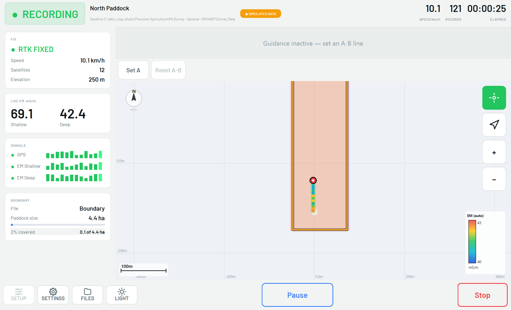
*Recording. The RTK FIXED status and signal rows should be green. The orange SIMULATED
DATA label means the data is not real, it should not show in the field.*

!!! warning "WARNING"
    If RadAssist or Subsoil sounds an alarm or shows a warning, stop and check the cables.
    The gamma box keeps recording while a cable is disconnected, so no data is lost. If
    **RTK LOST** appears, stop driving and wait for the green RTK FIX to return.

---

Next: [Data Collection & Export](04-data-collection.md). Back up and export at the end
of each paddock or day.
