# :material-database-export: Data Collection & Export

End the survey, back up the day's data off the gamma box, then convert and export it in
RadAssist. This follows on from [Gamma Rig Setup](03-gamma-setup.md). Do this at the end
of every paddock or day.

!!! info "AT A GLANCE"
    Stop in Subsoil, then USB backup off the gamma box, then load and export to shapefile
    in RadAssist, into the job's **Gamma** folder. No zip, no email, the folder syncs
    automatically. The gamma box only holds 24 hours, so never skip the USB backup.

## 1. End the survey in Subsoil

Pull over safely. Tap **Stop** in Subsoil, then tap **Yes** to confirm. The confirmation
defaults to **No**, so a mistap will not end the survey.

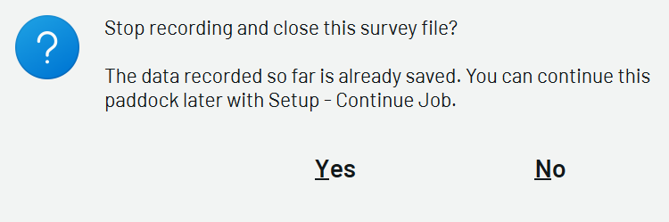
*Stop, then Yes. The data recorded so far is already saved.*

## 2. Back up to USB

Put a new USB thumbdrive into the gamma box. The USB automatically pulls the data off
the gamma box. Go into the **Event Log** at the bottom of RadAssist and check it says
**USB HDD Detected**. It will then start saving the files.

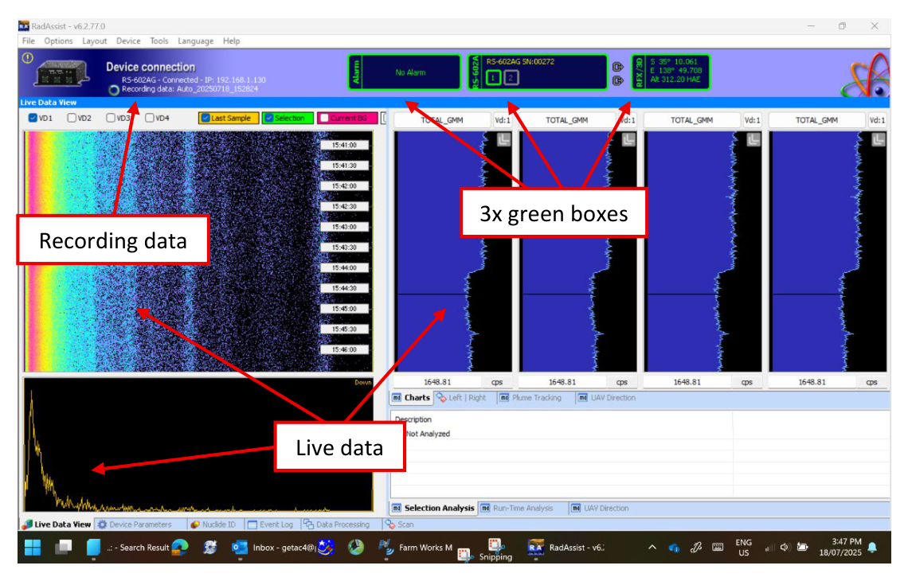
*USB port for the gamma USB, on the gamma box.*

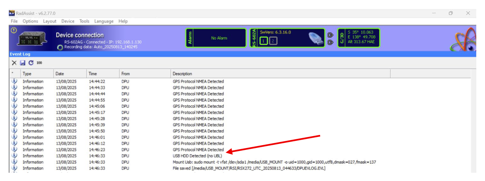
*USB HDD Detected, the backup has started.*

After waiting 2-3 minutes, the transfer should be complete. The Event Log will say
**USB HDD Backup Done** and **Unmount Usb**. You can now remove the thumbdrive.

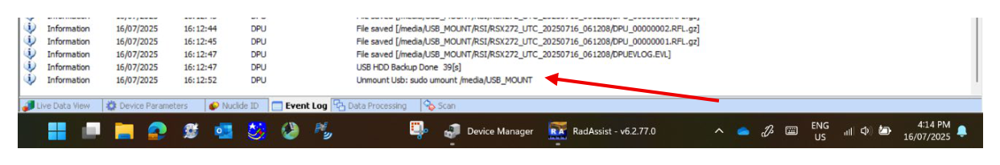
*Backup done and USB unmounted, safe to remove.*

The USB thumbdrive is reused. Once you have uploaded the files and confirmed they are
there, empty the USB.

## 3. Copy the file to the job folder

Plug the USB thumbdrive into the Getac. Open its files and check the **RSI** folder for
a file named `RSX…_UTC_<date and time in UTC>`. You can also check the **Date Modified**
column.

!!! example
    `RSX272_UTC_20250813_044633` = file from 13 August 2025.

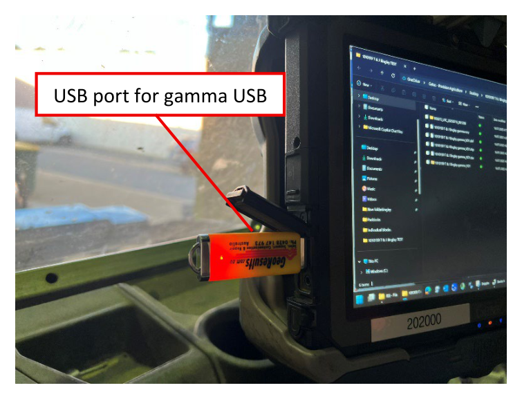
*USB thumbdrive in the Getac, with today's RSX folder.*

Copy this file into the job's **Gamma** folder in **PA Survey - General** (`PA Survey -
General - <Deal ID>`, then `Gamma`), into a folder named with today's date so each day
stays separate.

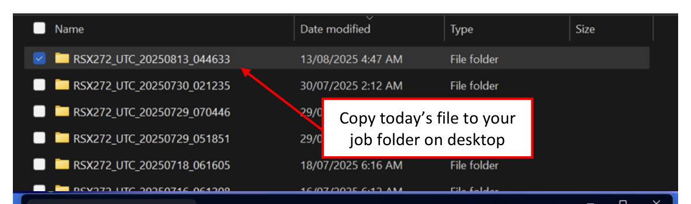
*Find today's RSX folder by its UTC timestamp and copy it.*

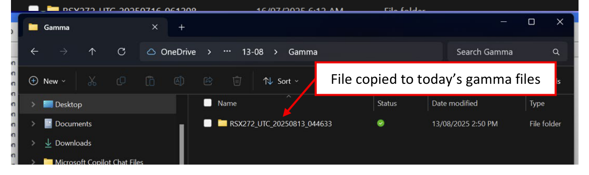
*File copied into today's gamma folder.*

## 4. Load the data in RadAssist

Open RadAssist and click the **Data Processing** tab. Click **Load**, then **Load Raw
Files Directory**. Select the folder you copied from the USB and press **OK**.

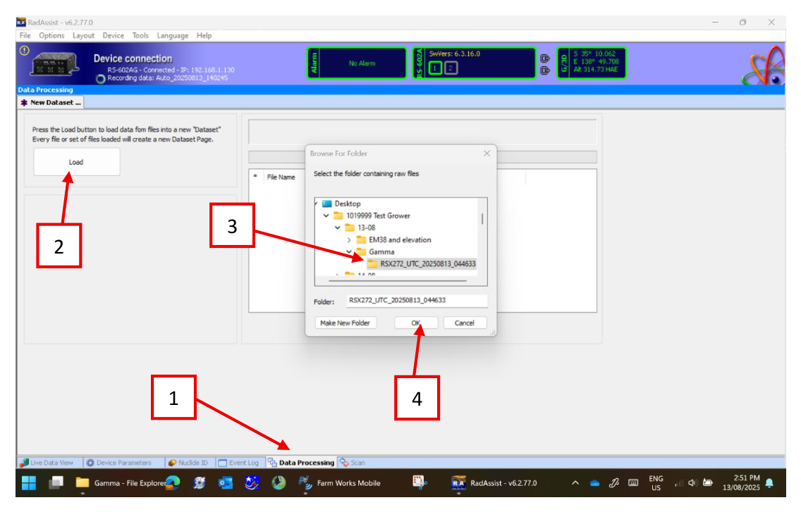
*Data Processing, Load, browse to the copied RSX folder, OK.*

If RadAssist warns that a compressed raw file was found, continue. If you have loaded
this folder before, pick the folder that was already unzipped.

Once loaded, check the Raw File Information window shows the files and samples loaded,
and that **RS-602 System Console** is set as the device type. Then click **Show Loaded
Data**.

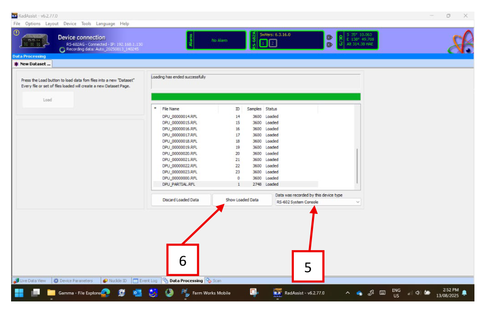
*Files loaded successfully, confirm the device type, then Show Loaded Data.*

## 5. Export to shapefile

Click **Export** in the bottom left.

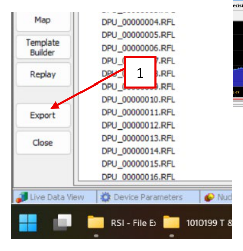
*Export, bottom left.*

Under **Data range**, select **All data**, then click **Next**.

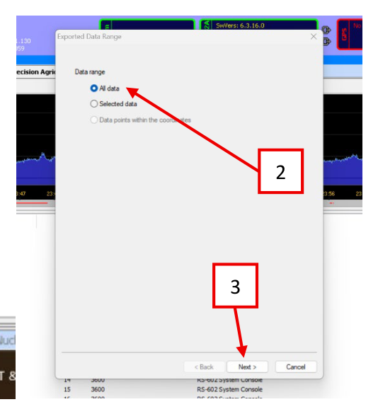
*All data, then Next.*

Under **Output format**, select **ESRI Shape File (SHP)**.

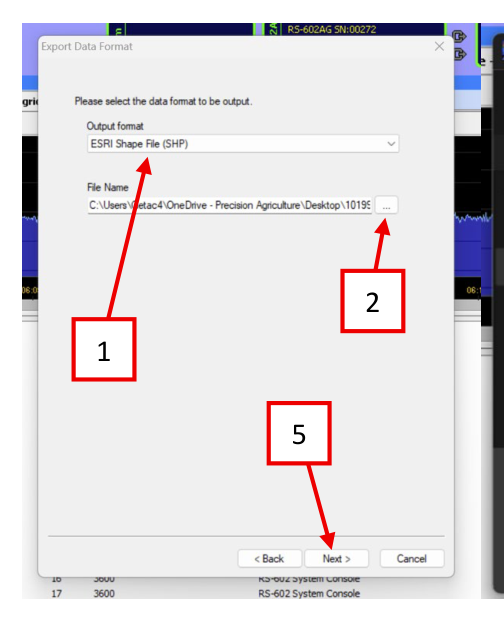
*Output format: ESRI Shape File (SHP).*

Under **File Name**, click the **…** button and browse to the job's **Gamma** folder in
**PA Survey - General** (`PA Survey - General - <Deal ID>`, then `Gamma`). Name the file **date + deal ID + grower name + gamma export**.

!!! example
    `13-08 1019999 Test Grower gamma export`

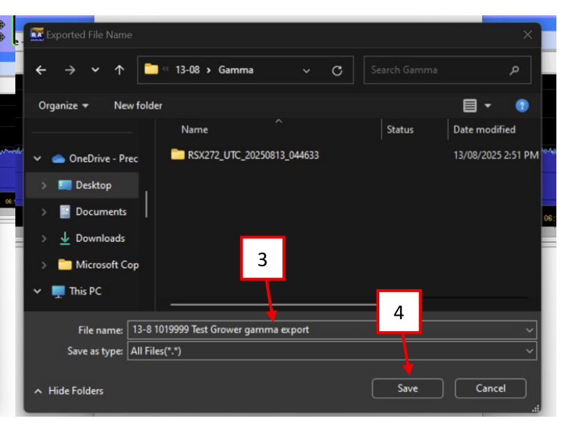
*Save with the date + deal ID + grower name + gamma export naming convention.*

Press **Save**, then **Next** back in RadAssist. Click **Next** through the following
pages, leaving the defaults, then **Finish**:

1. **SHAPE File Export Options**: leave the CSV box empty.
2. **Virtual Detector Configuration**: leave as it is.
3. **Ignore Errors**: leave unticked.
4. **Filter Samples**: leave empty.

-   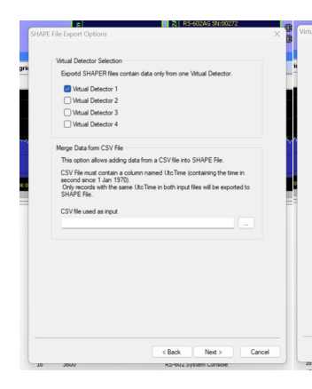
    SHAPE File Export Options, Next.

-   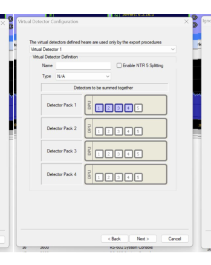
    Virtual Detector Configuration, Next.

-   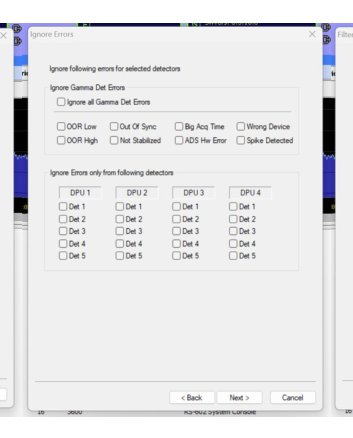
    Ignore Errors, Next.

-   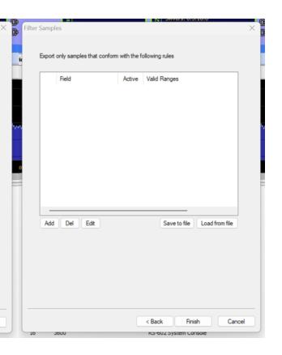
    Filter Samples, Finish.

Wait for the export to complete before closing RadAssist.

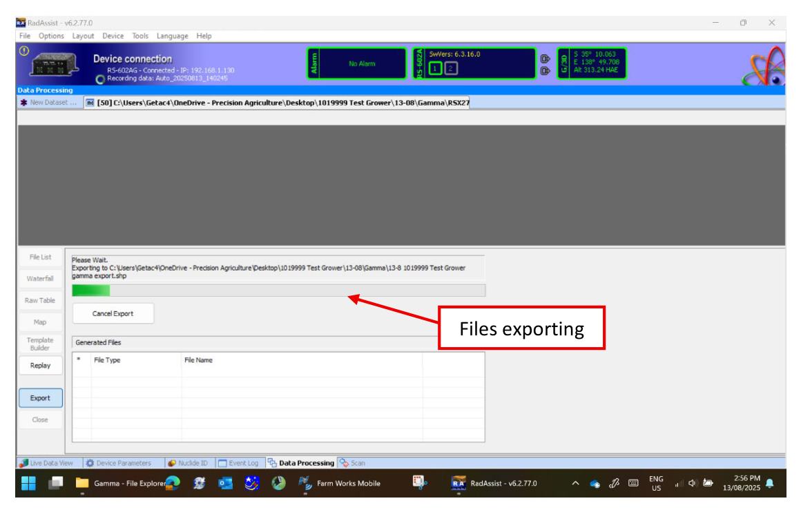
*Files exporting, wait for this to finish before closing RadAssist.*

To check the export, select the `.shp` file in the **Generated Files** list, click **Open
Selected File** and choose **Load Shape Files in RadAssist GIS View**.

## 6. Confirm it synced

That's it, there is no zip and no email. The shapefile is already inside the job's
**PA Survey - General** folder, which syncs automatically. Before you leave, confirm the
`.shp`, `.dbf` and `.shx` files are actually there, and that the sync status shows "up to
date" rather than pending.

When you have confirmed the files are uploaded, **empty the USB thumbdrive** so it is
ready for the next survey day.

!!! warning "WARNING"
    A file that exists locally is not the same as a file GIS can see. If the sync-status
    icon shows pending rather than "up to date" when you're about to leave, wait for it.
    Don't leave the field assuming it synced, see [Troubleshooting](06-troubleshooting.md).

---

Next: [Packup Procedure](05-packup.md). Pack down the rig at the end of the job.
